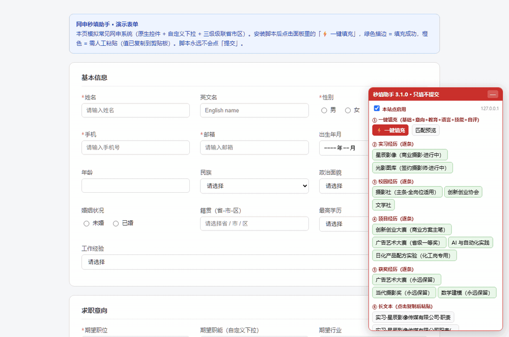

# quickfill · 网申秒填助手

[中文](README.md) | **English**

[](../../actions/workflows/ci.yml)
[](https://github.com/caesar280/quickfill/releases)

A Tampermonkey userscript that bulk-fills campus-recruitment online application forms from a single `profile.json`. Built during the 2026 autumn recruitment season and battle-tested against a dozen real ATS portals. **It fills forms. It never submits.**



> The demo uses placeholder data and never triggers form submission.

## Install

1. Install [Tampermonkey](https://www.tampermonkey.net/) if needed.
2. Install [quickfill.user.js](https://github.com/caesar280/quickfill/releases/latest/download/quickfill.user.js).
3. Open the target application page and choose **启用 quickfill（当前网站）** from the Tampermonkey menu.
4. Use the basic profile form in the bottom-right panel, or choose **编辑资料** to import a full `profile.json`.

The script is disabled by default on every site. It does not mount UI or inspect forms until enabled for that exact hostname.

## Why

Every company runs its own application portal. During job-hunting season you retype your name, school, internships and self-evaluation dozens of times. This script fills a whole page from one JSON file — with human review before anything is submitted.

## Features

- **Alias table**: one profile key matches every naming variant across ATS sites (`就读时间/入学时间`, `姓名/Name`)
- **Value hints**: dropdown option equivalence (`共青团员` ↔ `团员/共青团`)
- **Global unique matching**: all (field, control) pairs are scored, then greedily assigned one-to-one — controls never fight each other
- **Full control coverage**: native select / custom dropdown / radio groups / checkboxes / **3-level cascading region pickers** (with variant fallback) / date & month / ant-design date pickers
- **Job-type variants**: switch between marketing/production/QA/supply-chain profiles with one click — target function, lead experience, self-evaluation and block visibility all change
- **Cascader budget**: 6s hard deadline per cascader so one broken dropdown can't stall the whole queue (v3.1.0)
- **Visual feedback**: green outline = filled, orange = needs manual paste (value already copied to clipboard)
- **Hard safety line**: fields in `manual_fields` (ID numbers, passwords, verification codes) are never auto-filled; the submit button is always clicked by a human

## Usage

```bash
cp profile.example.json profile.json   # then edit with your own data
python build_v3.py                     # generates quickfill.user.js
```

Install the generated file in Tampermonkey, open any application page, click ⚡ 一键填充.

Try it safely on the bundled demo form: `demo/test.html` (serves a fake ATS form with all control types).

> `profile.json` and generated `*.user.js` contain your personal data — they are gitignored. Never commit or share them.

## Docs

- [profile.json field manual](docs/profile-schema.md) (Chinese)
- [Troubleshooting](docs/troubleshooting.md) (Chinese)

## Safety & disclaimer

- This tool only fills forms you open yourself. No batch submission, no CAPTCHA handling, no bypassing.
- Profile data stays in Tampermonkey storage. The script sends no network requests and contains no analytics or telemetry.
- The script only runs after the user explicitly enables it for that hostname.
- Review every field before submitting; the author takes no responsibility for mis-filled applications.

## License

MIT
